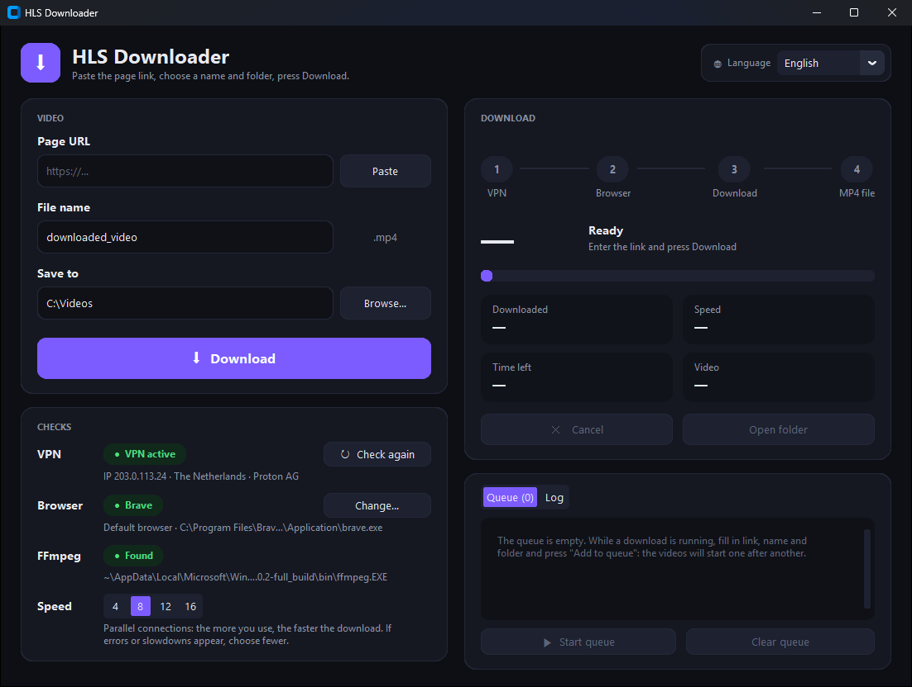

# HLS Downloader

A desktop app with a graphical interface that downloads **HLS (.m3u8)** video streams and saves them as **MP4**, without re-encoding.
Paste the link of the page that contains the video: the app opens it in the browser, finds the stream, downloads the segments in parallel and merges them with FFmpeg.


> [!IMPORTANT]
> Use this program **only with content you have the right to download**: your own videos, freely licensed content, or services that allow downloading.
> Downloading copyrighted works without permission may infringe copyright and the terms of service of the sites involved. The author is not responsible for how the software is used.
> The app **does not bypass DRM** (Widevine, PlayReady, FairPlay) and does not work with sites that block download tools.



## Features

- **Graphical interface** with a dark theme, available in 5 languages (Italian, English, Spanish, French, Japanese).
- **Automatic stream capture**: opens the page in the browser and starts the player by itself.
- **No ads by mistake**: among the streams found, it picks the main video (the longest one).
- **Pop-up and page-hijack blocking** while looking for the stream.
- **Parallel downloads** (4–16 connections) over reused connections.
- **Resume**: if the link expires it reopens the page and downloads only the missing segments; after an unexpected shutdown it picks up where it left off.
- **Download queue**: add more videos while one is downloading, reorder them or remove them.
- **Best available video quality**, with **all audio tracks** (Italian as default) and **subtitles** saved as `.srt`.
- **Merge without re-encoding** using FFmpeg, even for very long videos.
- **Progress bar** with speed, time remaining and estimated finish time.
- **Privacy**: VPN check before each download, WebRTC disabled, and an incognito window with a temporary profile.
- **Uses your default browser** (Brave, Chrome, Edge, Vivaldi).
- **Automatic installation** of the Python libraries on first launch.

## Requirements

| What | Notes |
|---|---|
| **Python 3.10+** | With Tkinter (already included in the official Windows installer). |
| **Chromium-based browser** | Brave, Google Chrome, Microsoft Edge or Vivaldi. |
| **FFmpeg 6.0+** | Recommended. Older versions work, but merging needs more disk space. |

## Installation

```bash
git clone https://github.com/loll019/hls-downloader.git
cd hls-downloader
python hls_downloader.py
```

On first launch the app installs any missing libraries by itself (`playwright`, `customtkinter`, `pycryptodome`).
You can also install them manually:

```bash
python -m pip install -r requirements.txt
```

**FFmpeg**: on Windows run `winget install Gyan.FFmpeg`, or copy `ffmpeg.exe` into the same folder as `hls_downloader.py`.
On Linux use your package manager (`sudo apt install ffmpeg`), on macOS `brew install ffmpeg`.

You don't need `playwright install chromium`: the app uses the browser already installed on your computer.

## Usage

1. Paste the **link of the page** that contains the video.
2. Choose the **file name** and the **folder** to save it in.
3. Press **Download**. While a download is running, the button becomes **Add to queue**.
4. Follow the progress in the *Download* panel; technical details are in the *Log* tab.

If the player does not start by itself, press Play in the browser window opened by the app.

## How it works

1. **Browser**: opens the page with Playwright, in a temporary profile separate from your personal one.
2. **Capture**: collects the `.m3u8` playlists loaded by the page, measures their duration and picks the main video.
3. **Tracks**: from the playlist it selects the highest video quality, all audio languages and the subtitles.
4. **Download**: downloads the segments in parallel, decrypts them if they use AES-128 (standard HLS encryption) and stores them in a temporary folder `<name>.mp4.download`.
5. **Merge**: FFmpeg combines video and audio into an MP4 without re-encoding; the file only appears once it is complete, and the temporary folder is then deleted.

During a download you need free disk space of about twice the size of the video.

## Privacy

- The **VPN check** looks up your public IP, country and provider using `ip-api.com`; if it is unreachable (for example blocked by your VPN's ad/tracker blocker) it falls back to `ipwho.is`, `ipinfo.io` and `api.ipify.org`. The app sends no other data to external services.
- Paths inside your user folder are shown as `~\...`, so your username does not appear on screen.
- Preferences (language, folder, connections, manually chosen browser) are stored in `~/.hls_downloader.json`.
- The browser opened by the app runs in incognito mode: history, cookies and cache are deleted when it closes.

## Troubleshooting

| Problem | Solution |
|---|---|
| **The stream is not found** | Press Play in the browser window within 60 seconds. |
| **No compatible browser** | Install Brave, Chrome, Edge or Vivaldi, or select one with the *Change…* button. |
| **FFmpeg not found** | Install it or copy `ffmpeg.exe` into the program folder, then restart the app. |
| **Repeated 403 error** | The server is refusing the download. In the *Log*, the line "Before the refusal: N segments saved, M of them reused from the browser" with N equal to M means the site does not allow downloads from the app. |
| **Slow download** | Increase the connections in the *Checks* panel. If errors appear, reduce them. |
| **The browser does not start** | Update Playwright: `python -m pip install -U playwright`. |

## License

Released under the [MIT](LICENSE) license.
